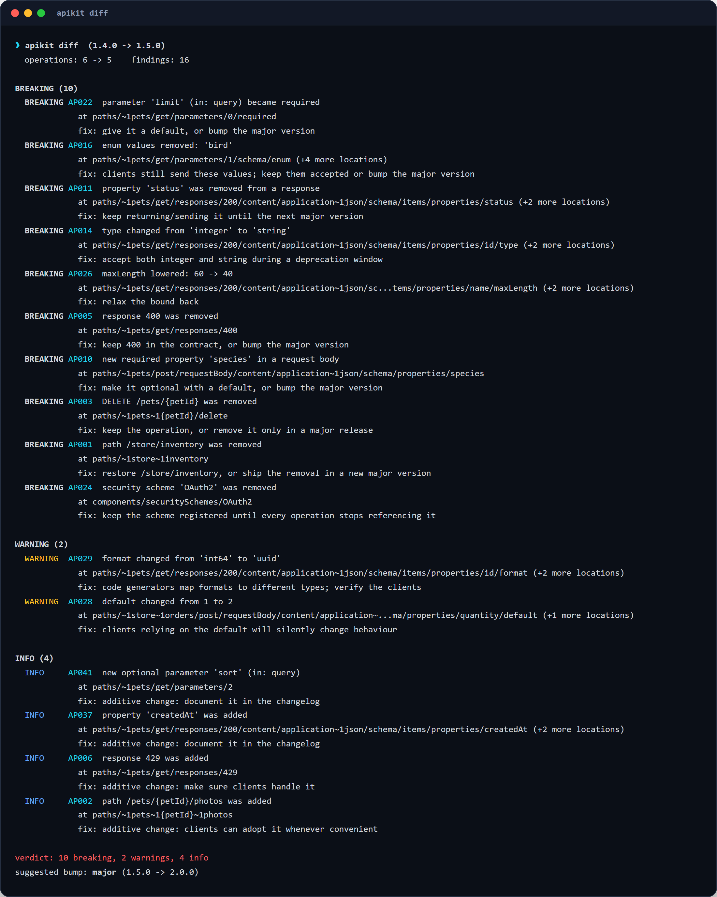
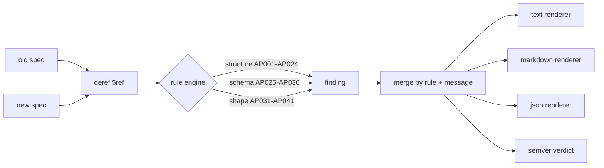

# apikit

**English** | [简体中文](README.zh-CN.md)

**Fail your CI on an API change that would break a client, before you ship it.**

```
[](https://github.com/kele-tao/apikit/actions/workflows/ci.yml)


```



`apikit` is a dependency-free Python CLI with three jobs that share one contract:
**diff** two OpenAPI 3 specs and say exactly what breaks, **mock** the contract
deterministically so client teams can build against it today, and **sign** requests
with HMAC-SHA256 so the mock and the real service speak the same language.

## The problem

A REST API is a contract, and nobody reviews the contract. A field is renamed, the
OpenAPI file is regenerated, the test suite is green, and three weeks later a mobile
client in production receives `null` where it expected an integer. The failure is
discovered by users, not by CI.

Diffing two spec dumps as text produces thousands of lines where a type change and a
formatting change look identical. Client generators are all-or-nothing. And the one
question every team needs - *would this merge break anyone?* - is a judgement call
nobody has time to make.

apikit makes that judgement mechanically. It knows which direction is safe: adding an
optional property is fine, removing an enum value is not. Each finding gets a
severity, a JSON pointer and a one-line fix; the aggregate gets a semver verdict.

## What it does

* **`diff`** - 41 documented rules over paths, operations, parameters, request
  bodies, responses, media types, security schemes, enums, constraints, formats,
  composition, discriminators and deprecations, each with a JSON pointer, a one-line
  fix and a suggested semver bump.
* **`mock`** - a real HTTP server on the standard library: seeded schema-driven
  data, path/query coercion, body validation with RFC 7807 `problem+json` errors,
  404/405 with `Allow`, `--latency`, `--error-rate`, `--cors`, `--stateful`,
  colour access log.
* **`sign` / `verify`** - HMAC-SHA256 over a canonical request string, timing-safe
  comparison, replay window and nonce cache, with seven committed test vectors.
* **`examples`** - paste-ready `curl`, HTTPie and Python snippets per operation.
* **`rules`** - the severity registry on stdout, auditable without reading the source.
* **Library API** - `from apikit import diff_specs`, so CI does not have to shell out.

Zero runtime dependencies. `pyyaml` is an optional extra for reading YAML specs.

## Install

apikit is not on PyPI yet. Install from source:

```bash
git clone https://github.com/kele-tao/apikit.git
cd apikit
python -m pip install -e .
apikit --version
# apikit 1.0.0
```

YAML specs need the optional extra; without it apikit tells you exactly what to run:

```bash
python -m pip install -e ".[yaml]"
```

It also runs uninstalled: `python -m apikit diff old.json new.json`.

### Exit codes

| Code | Meaning |
| --- | --- |
| 0 | success, nothing at or above the `--fail-on` threshold |
| 1 | findings at or above the threshold (or an invalid signature) |
| 2 | usage error, unreadable spec, unsupported version |

## Usage

### 1. Catch a breaking change in CI

`examples/petstore.v1.json` and `examples/petstore.v2.json` are a real pair. v2 removes a
path, removes a method, adds a required request property, tightens an enum, changes a
field type, removes a response code, makes a query parameter required, drops a
security scheme, removes a response field and lowers `maxLength` - plus five harmless
changes (four additive, one changed default) so all three severities appear.

```console
$ apikit diff examples/petstore.v1.json examples/petstore.v2.json
apikit diff  (1.4.0 -> 1.5.0)
  operations: 6 -> 5    findings: 16

BREAKING (10)
  BREAKING AP022  parameter 'limit' (in: query) became required
             at paths/~1pets/get/parameters/0/required
             fix: give it a default, or bump the major version
  BREAKING AP016  enum values removed: 'bird'
             at paths/~1pets/get/parameters/1/schema/enum (+4 more locations)
             fix: clients still send these values; keep them accepted or bump the major version
  BREAKING AP011  property 'status' was removed from a response
             at paths/~1pets/get/responses/200/content/application~1json/schema/items/properties/status (+2 more locations)
             fix: keep returning/sending it until the next major version
  BREAKING AP014  type changed from 'integer' to 'string'
             at paths/~1pets/get/responses/200/content/application~1json/schema/items/properties/id/type (+2 more locations)
             fix: accept both integer and string during a deprecation window
  BREAKING AP026  maxLength lowered: 60 -> 40
             at paths/~1pets/get/responses/200/content/application~1json/sc...tems/properties/name/maxLength (+2 more locations)
             fix: relax the bound back
  BREAKING AP005  response 400 was removed
             at paths/~1pets/get/responses/400
             fix: keep 400 in the contract, or bump the major version
  BREAKING AP010  new required property 'species' in a request body
             at paths/~1pets/post/requestBody/content/application~1json/schema/properties/species
             fix: make it optional with a default, or bump the major version
  BREAKING AP003  DELETE /pets/{petId} was removed
             at paths/~1pets~1{petId}/delete
             fix: keep the operation, or remove it only in a major release
  BREAKING AP001  path /store/inventory was removed
             at paths/~1store~1inventory
             fix: restore /store/inventory, or ship the removal in a new major version
  BREAKING AP024  security scheme 'OAuth2' was removed
             at components/securitySchemes/OAuth2
             fix: keep the scheme registered until every operation stops referencing it

WARNING (2)
  WARNING  AP029  format changed from 'int64' to 'uuid'
             at paths/~1pets/get/responses/200/content/application~1json/schema/items/properties/id/format (+2 more locations)
             fix: code generators map formats to different types; verify the clients
  WARNING  AP028  default changed from 1 to 2
             at paths/~1store~1orders/post/requestBody/content/application~1json/sc...ma/properties/quantity/default (+1 more locations)
             fix: clients relying on the default will silently change behaviour

INFO (4)
  INFO     AP041  new optional parameter 'sort' (in: query)
             at paths/~1pets/get/parameters/2
             fix: additive change: document it in the changelog
  INFO     AP037  property 'createdAt' was added
             at paths/~1pets/get/responses/200/content/application~1json/schema/items/properties/createdAt (+2 more locations)
             fix: additive change: document it in the changelog
  INFO     AP006  response 429 was added
             at paths/~1pets/get/responses/429
             fix: additive change: make sure clients handle it
  INFO     AP002  path /pets/{petId}/photos was added
             at paths/~1pets~1{petId}~1photos
             fix: additive change: clients can adopt it whenever convenient

verdict: 10 breaking, 2 warnings, 4 info
suggested bump: major (1.5.0 -> 2.0.0)
$ echo $?
1
```

Note the `(+4 more locations)` markers: a shared schema is dereferenced into every
operation that uses it, so the same incompatibility would otherwise be reported five
times. Findings that share a rule and a message are merged; every location survives in
`--format json`.

`--format md` renders the same result as a table for a pull request. The
full generated report for this pair is committed at
[docs/diff-report.md](docs/diff-report.md); the first rows:

```console
$ apikit diff examples/petstore.v1.json examples/petstore.v2.json --format md
## apikit compatibility report

`1.4.0` -> `1.5.0` | operations 6 -> 5 | **suggested bump: major**

| severity | rule | location | finding | fix |
| --- | --- | --- | --- | --- |
| breaking | AP024 | `components/securitySchemes/OAuth2` | security scheme 'OAuth2' was removed | keep the scheme registered until every operation stops referencing it |
| breaking | AP001 | `paths/~1store~1inventory` | path /store/inventory was removed | restore /store/inventory, or ship the removal in a new major version |
| breaking | AP003 | `paths/~1pets~1{petId}/delete` | DELETE /pets/{petId} was removed | keep the operation, or remove it only in a major release |
```

### 2. Run a deterministic mock of the contract

```console
$ apikit mock examples/petstore.v1.json --port 8787 --seed 42
apikit mock serving examples/petstore.v1.json
  http://127.0.0.1:8787  (Ctrl+C to stop)
```

In another terminal, against the same seed:

```console
$ curl -s 'http://127.0.0.1:8787/pets?limit=2'
[ { "id": 964, "name": "marble-981", "tag": "bird", "status": "pending" },
  { "id": 120, "name": "kelp-665", "tag": "bird", "status": "pending" } ]

$ curl -s -X POST 'http://127.0.0.1:8787/pets' -H 'Content-Type: application/json' \
    --data-binary '@examples/new_pet.json'
{ "id": 421, "name": "cobalt-277", "tag": "cat", "status": "available" }

$ curl -s -X POST 'http://127.0.0.1:8787/pets' -H 'Content-Type: application/json' \
    --data-binary '@examples/bad_pet.json'
{
  "type": "https://apikit.dev/problems/unprocessable-entity",
  "title": "Unprocessable Entity",
  "status": 422,
  "detail": "request body does not match the contract",
  "errors": [
    { "pointer": "body.name", "detail": "string shorter than minLength 1" },
    { "pointer": "body.tag", "detail": "expected one of ['dog', 'cat', 'bird'], got 'dragon'" }
  ]
}

$ curl -s 'http://127.0.0.1:8787/nope'
{ "type": "https://apikit.dev/problems/not-found", "title": "Not Found",
  "status": 404, "detail": "no route in the spec matches /nope" }
```

The access log on stderr, with status codes coloured:

```
15:56:41 GET    /pets?limit=2                    200 0.0ms
15:56:41 POST   /pets                            201 0.0ms
15:56:41 POST   /pets                            422 0.0ms
15:56:41 GET    /nope                            404 0.0ms
```

(JSON re-wrapped for width; bodies are byte-for-byte what the server returned.) The
same seed and operation always produce the same body regardless of request order -
that property is what lets you assert on a committed fixture.

### 3. Sign and verify a request

```console
$ apikit sign --secret demo-secret --method POST \
    --url 'https://api.example.com/v1/pets?limit=5' \
    --body-file examples/new_pet.json --timestamp 1764000000 --nonce nonce-demo-0001
X-Apikit-Timestamp: 1764000000
X-Apikit-Nonce: nonce-demo-0001
X-Apikit-Signature: v1=82ab7116e201ca8b156423435c5ea38d98cf535309ab7cb46158bd708ebd349b
X-Apikit-Signed-Headers: x-apikit-timestamp;x-apikit-nonce

$ apikit verify --secret demo-secret --method POST \
    --url 'https://api.example.com/v1/pets?limit=5' \
    --body-file examples/new_pet.json --timestamp 1764000000 \
    --nonce nonce-demo-0001 --signature v1=82ab7116...349b --window 999999999
signature valid

$ apikit verify ... --body-file examples/bad_pet.json
signature invalid [bad_signature]: signature does not match the request
$ echo $?
1
```

Canonical layout, verification order and the seven test vectors:
[docs/SIGNING.md](docs/SIGNING.md).

### 4. Generate snippets for a ticket

```console
$ apikit examples examples/petstore.v1.json --base-url http://127.0.0.1:8787
POST /pets  (Create a pet)
--------------------------
curl:
  curl -sS -X POST 'http://127.0.0.1:8787/pets' -H 'Content-Type: application/json' -d '{"name":"falcon-975","tag":"dog"}'
httpie:
  http POST http://127.0.0.1:8787/pets Content-Type:application/json <<< '{"name":"falcon-975","tag":"dog"}'
python:
  import json, urllib.request
  payload = json.dumps({"name":"falcon-975","tag":"dog"}).encode()
  request = urllib.request.Request('http://127.0.0.1:8787/pets', data=payload,
      method='POST', headers={'Content-Type': 'application/json'})
  with urllib.request.urlopen(request) as response:
      print(response.status, response.read().decode())
```

## Use it from Python

```python
from apikit import diff_specs, load_document

result = diff_specs(load_document("old.json"), load_document("new.json"))
for finding in result.breaking:
    print(finding.code, finding.location, finding.message)

if result.breaking:
    raise SystemExit(f"{len(result.breaking)} breaking changes, bump {result.suggested_bump}")
```

## In GitHub Actions

```yaml
name: api-compat
on: [pull_request]
jobs:
  compatibility:
    runs-on: ubuntu-latest
    steps:
      - uses: actions/checkout@v4
        with:
          fetch-depth: 0
      - uses: actions/setup-python@v5
        with:
          python-version: "3.12"
      - run: pip install -e ".[dev]"
      - name: Fetch the base spec
        run: git show origin/${{ github.base_ref }}:openapi.json > base.json
      - name: Fail on breaking changes
        run: apikit diff base.json openapi.json --fail-on breaking --format md >> $GITHUB_STEP_SUMMARY
```

The Markdown lands in the job summary, which is where reviewers actually look.

## How it works



Both documents are dereferenced first, so a shared schema is compared in every
operation that uses it. The rule engine walks paths, operations, parameters, request
bodies, responses, media types and nested schemas and records a finding for each
incompatibility it recognises; findings that share a rule code and a message are then
merged into one. Severity comes from the rule table, not from a heuristic: *property
removed from a response* is breaking, *property removed from a request* is only a
warning because the server simply ignores it, and a numeric widening from `integer`
to `number` is informational because most clients parse both. The table is generated
into [docs/RULES.md](docs/RULES.md) by `python benchmarks/gen_rules.py`, so a rule cannot
exist without documentation.

The mock compiles each path template into an anchored regex, coerces path and query
strings to the declared types, validates the body against the schema subset in
`validate.py`, and generates the response with an RNG seeded per schema node rather
than per request. The signing scheme is six newline-separated fields signed with
HMAC-SHA256. Details: [docs/ARCHITECTURE.md](docs/ARCHITECTURE.md).

## Design decisions

**Merge findings by rule and message, not by occurrence.** A schema used by six
endpoints produces six structurally identical findings; listing all of them is
complete and useless because the reader stops reading at line 30. apikit reports the
first location, appends `(+N more locations)` and keeps the full list in JSON. The
tradeoff: merged findings hide per-endpoint nuance, which cannot exist here because
severity is a property of the rule, not of the usage site.

**Rules over generic structural diffing.** An AST diff of two JSON documents lists the
changed nodes and has no opinion about whether they matter. The value is the opinion -
*"`maxLength` lowered on a response breaks clients"* is a claim about what clients rely
on. Encoding it in 41 named rules makes it auditable and stable; the cost is that an
unanticipated change can be under-reported, which is why every rule is documented.

**Determinism is a feature of the mock.** A mock returning random data is only good for
eyeballing a UI. Seeding per operation and per schema node makes `GET /pets/1`
byte-identical on every run, which is what makes the mock usable as a test double. The
tradeoff: run a second job with a different `--seed` if you need value diversity.

## Performance

Measured by `python benchmarks/run.py` on Windows 11, Python 3.12.10, on this
repository's machine. Re-run it before quoting these numbers; full output in
[benchmarks/RESULTS.md](benchmarks/RESULTS.md).

| Workload | Size | Median | Notes |
| --- | ---: | ---: | --- |
| `diff`, petstore pair | 6 operations | 0.8 ms | 16 findings |
| `diff`, synthetic pair | 300 operations, 40 schemas | 59.1 ms | 251 raw hits merged to 3 |
| `mock`, loopback | 1 client, validation on | 374 req/s | p50 2.2 ms, p95 3.4 ms |
| `sign` | HMAC-SHA256 | 54,749 ops/s | includes canonical string |
| `verify` | full check incl. window | 54,271 ops/s | 18.4 us per signature |

A 300-operation spec diffs in 59 ms, so this is usable as a pre-commit hook, not just
as a CI step.

## Comparison

| | apikit | [oasdiff](https://github.com/Tufin/oasdiff) | [openapi-diff](https://github.com/OpenAPITools/openapi-diff) | [Prism](https://github.com/stoplightio/prism) |
| --- | --- | --- | --- | --- |
| Breaking-change detection | yes, 41 rules | yes, far more rules | yes | no |
| Runtime | Python, 0 deps | Go binary | Java | Node |
| Deterministic mock from the spec | yes, same binary | no | no | yes, richer |
| Request signing | yes | no | no | no |
| Semver verdict | yes | partially | no | no |
| OpenAPI 3.1 | loads; ref siblings not modelled | yes | partial | partial |

oasdiff has a larger, battle-tested rule set: if you only need a diff on a Go stack,
use it. openapi-diff is the mature JVM option; Prism is the far more capable mock.
apikit's bet is the combination - one small Python package you can vendor into a CI
image, with the mock and the signing scheme speaking the same contract.

## Roadmap

[docs/ROADMAP.md](docs/ROADMAP.md) lists what v1.0 deliberately does not do. Next:

1. `validate --requests log.jsonl` - replay a captured request log against the spec.
2. `X-Apikit-Status` - force a mocked status so clients can test error paths.
3. Per-rule severity overrides via `.apikit.json`.

## Contributing

Read [CONTRIBUTING.md](CONTRIBUTING.md); the short version is one behaviour change per
PR, a test that fails before it, and no new runtime dependencies.

```bash
python -m pip install -e ".[dev]"
python -m pytest -q
python -m ruff check .
python benchmarks/run.py
```

## License

MIT - see [LICENSE](LICENSE). Copyright (c) 2026 kele.
