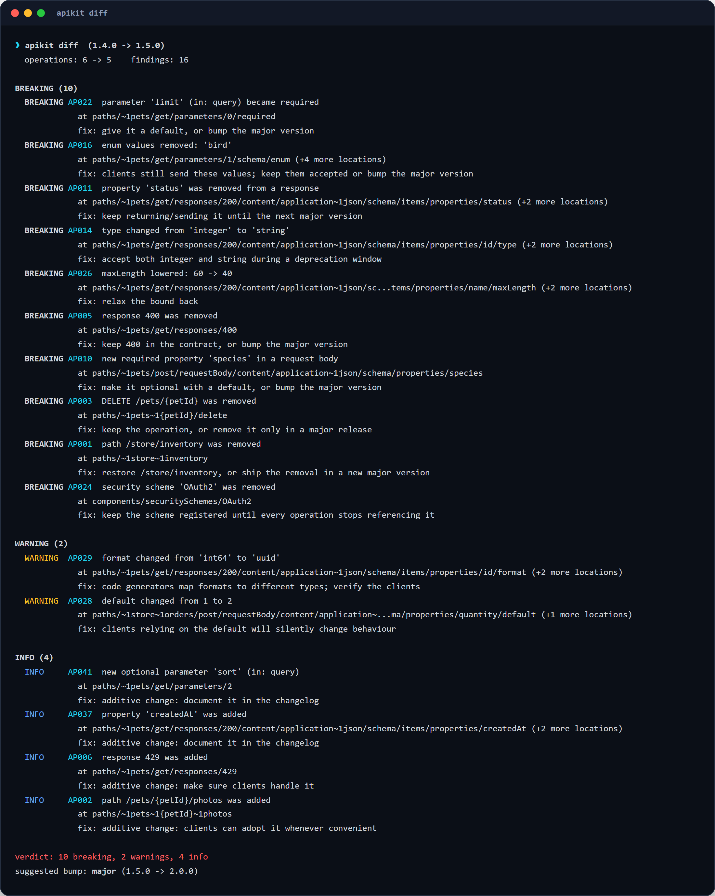
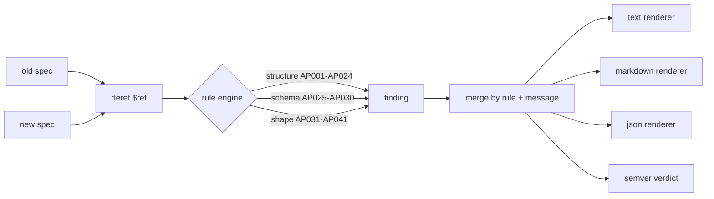

# apikit

[English](README.md) | **简体中文**

**在 API 变更破坏客户端之前，就让 CI 失败。**

```
[](https://github.com/kele-tao/apikit/actions/workflows/ci.yml)


```



`apikit` 是一个零依赖的 Python 命令行工具，三件事共用同一份契约：**diff** 对比两份 OpenAPI 3 规范并说清楚哪里会破坏兼容，**mock** 确定性地模拟这份契约，让客户端团队今天就能开始对接，**sign** 用 HMAC-SHA256 给请求签名，让 mock 与真实服务说同一种语言。

## 问题

REST API 是一份契约，但没有人审阅这份契约。某个字段被改名，OpenAPI 文件被重新生成，测试套件仍然是绿的，三周之后线上一个移动端客户端在本该收到整数的地方收到了 `null`。问题由用户发现，而不是由 CI 发现。

把两份规范快照当作文本做 diff，会得到几千行输出，其中类型变更和格式调整看起来一模一样。客户端生成器要么全做、要么全不做。而每个团队都需要的那个问题——*这次合并会不会破坏别人？*——是一句没人有时间去做的人工判断。

apikit 把这句判断变成机械过程。它分得清哪个方向是安全的：新增可选属性没问题，删除枚举值不行。每条结果都带严重级别、一个 JSON 指针和一行修复建议；汇总结果给出 semver 结论。

## 它能做什么

* **`diff`** - 41 条有文档的规则，覆盖路径、操作、参数、请求体、响应、媒体类型、安全方案、枚举、约束、格式、组合、判别器和弃用标记，每条规则都有 JSON 指针、一行修复建议和建议的 semver 版本提升。
* **`mock`** - 基于标准库实现的真实 HTTP 服务：按模式（schema）生成的确定性数据、路径与查询参数的类型转换、请求体校验并返回 RFC 7807 `problem+json` 错误、带 `Allow` 头的 404/405、`--latency`、`--error-rate`、`--cors`、`--stateful`、彩色访问日志。
* **`sign` / `verify`** - 对规范化（canonical）请求字符串做 HMAC-SHA256、时间安全（timing-safe）比较、重放窗口与 nonce 缓存，附带七个已提交进仓库的测试向量。
* **`examples`** - 为每个操作生成可直接粘贴的 `curl`、HTTPie 和 Python 代码片段。
* **`rules`** - 把严重级别注册表输出到 stdout，不读源码也能审计。
* **Library API** - `from apikit import diff_specs`，CI 里不必再 shell 出去调命令行。

零运行时依赖。读取 YAML 规范需要可选依赖 `pyyaml`。

## 安装

apikit 尚未发布到 PyPI，请从源码安装：

```bash
git clone https://github.com/kele-tao/apikit.git
cd apikit
python -m pip install -e .
apikit --version
# apikit 1.0.0
```

YAML 规范需要可选依赖；没装的时候 apikit 会明确告诉你该执行什么命令：

```bash
python -m pip install -e ".[yaml]"
```

它也可以不安装直接运行：`python -m apikit diff old.json new.json`。

### 退出码

| 退出码 | 含义 |
| --- | --- |
| 0 | 成功，没有达到或超过 `--fail-on` 阈值的结果 |
| 1 | 存在达到或超过阈值的结果（或签名无效） |
| 2 | 用法错误、规范无法读取、版本不受支持 |

## 用法

### 1. 在 CI 里捕获破坏性变更

`examples/petstore.v1.json` 与 `examples/petstore.v2.json` 是一组真实的前后对照。v2 删除了一条路径、删除了一个方法、新增了一个必填的请求属性、收紧了枚举、修改了字段类型、删除了一个响应码、把一个查询参数改成必填、去掉了一个安全方案、删除了一个响应字段，并调低了 `maxLength` —— 此外还有五处无害变更（四处新增，一处默认值变化），好让三种严重级别都出现。

```console
$ apikit diff examples/petstore.v1.json examples/petstore.v2.json
apikit diff  (1.4.0 -> 1.5.0)
  operations: 6 -> 5    findings: 16

BREAKING (10)
  BREAKING AP022  parameter 'limit' (in: query) became required
             at paths/~1pets/get/parameters/0/required
             fix: give it a default, or bump the major version
  BREAKING AP016  enum values removed: 'bird'
             at paths/~1pets/get/parameters/1/schema/enum (+4 more locations)
             fix: clients still send these values; keep them accepted or bump the major version
  BREAKING AP011  property 'status' was removed from a response
             at paths/~1pets/get/responses/200/content/application~1json/schema/items/properties/status (+2 more locations)
             fix: keep returning/sending it until the next major version
  BREAKING AP014  type changed from 'integer' to 'string'
             at paths/~1pets/get/responses/200/content/application~1json/schema/items/properties/id/type (+2 more locations)
             fix: accept both integer and string during a deprecation window
  BREAKING AP026  maxLength lowered: 60 -> 40
             at paths/~1pets/get/responses/200/content/application~1json/sc...tems/properties/name/maxLength (+2 more locations)
             fix: relax the bound back
  BREAKING AP005  response 400 was removed
             at paths/~1pets/get/responses/400
             fix: keep 400 in the contract, or bump the major version
  BREAKING AP010  new required property 'species' in a request body
             at paths/~1pets/post/requestBody/content/application~1json/schema/properties/species
             fix: make it optional with a default, or bump the major version
  BREAKING AP003  DELETE /pets/{petId} was removed
             at paths/~1pets~1{petId}/delete
             fix: keep the operation, or remove it only in a major release
  BREAKING AP001  path /store/inventory was removed
             at paths/~1store~1inventory
             fix: restore /store/inventory, or ship the removal in a new major version
  BREAKING AP024  security scheme 'OAuth2' was removed
             at components/securitySchemes/OAuth2
             fix: keep the scheme registered until every operation stops referencing it

WARNING (2)
  WARNING  AP029  format changed from 'int64' to 'uuid'
             at paths/~1pets/get/responses/200/content/application~1json/schema/items/properties/id/format (+2 more locations)
             fix: code generators map formats to different types; verify the clients
  WARNING  AP028  default changed from 1 to 2
             at paths/~1store~1orders/post/requestBody/content/application~1json/sc...ma/properties/quantity/default (+1 more locations)
             fix: clients relying on the default will silently change behaviour

INFO (4)
  INFO     AP041  new optional parameter 'sort' (in: query)
             at paths/~1pets/get/parameters/2
             fix: additive change: document it in the changelog
  INFO     AP037  property 'createdAt' was added
             at paths/~1pets/get/responses/200/content/application~1json/schema/items/properties/createdAt (+2 more locations)
             fix: additive change: document it in the changelog
  INFO     AP006  response 429 was added
             at paths/~1pets/get/responses/429
             fix: additive change: make sure clients handle it
  INFO     AP002  path /pets/{petId}/photos was added
             at paths/~1pets~1{petId}~1photos
             fix: additive change: clients can adopt it whenever convenient

verdict: 10 breaking, 2 warnings, 4 info
suggested bump: major (1.5.0 -> 2.0.0)
$ echo $?
1
```

注意 `(+4 more locations)` 标记：共享 schema 会被解引用到每个使用它的操作里，否则同一处不兼容会被报告五次。规则码和消息都相同的结果会被合并，每条位置在 `--format json` 中完整保留。

`--format md` 会把同样的结果渲染成适合放在 pull request 里的表格。这一对规范的完整报告已提交在 [docs/diff-report.md](docs/diff-report.md)，下面是前几行：

```console
$ apikit diff examples/petstore.v1.json examples/petstore.v2.json --format md
## apikit compatibility report

`1.4.0` -> `1.5.0` | operations 6 -> 5 | **suggested bump: major**

| severity | rule | location | finding | fix |
| --- | --- | --- | --- | --- |
| breaking | AP024 | `components/securitySchemes/OAuth2` | security scheme 'OAuth2' was removed | keep the scheme registered until every operation stops referencing it |
| breaking | AP001 | `paths/~1store~1inventory` | path /store/inventory was removed | restore /store/inventory, or ship the removal in a new major version |
| breaking | AP003 | `paths/~1pets~1{petId}/delete` | DELETE /pets/{petId} was removed | keep the operation, or remove it only in a major release |
```

### 2. 运行确定性的契约 mock

```console
$ apikit mock examples/petstore.v1.json --port 8787 --seed 42
apikit mock serving examples/petstore.v1.json
  http://127.0.0.1:8787  (Ctrl+C to stop)
```

在另一个终端里，对同一个 seed 发起请求：

```console
$ curl -s 'http://127.0.0.1:8787/pets?limit=2'
[ { "id": 964, "name": "marble-981", "tag": "bird", "status": "pending" },
  { "id": 120, "name": "kelp-665", "tag": "bird", "status": "pending" } ]

$ curl -s -X POST 'http://127.0.0.1:8787/pets' -H 'Content-Type: application/json' \
    --data-binary '@examples/new_pet.json'
{ "id": 421, "name": "cobalt-277", "tag": "cat", "status": "available" }

$ curl -s -X POST 'http://127.0.0.1:8787/pets' -H 'Content-Type: application/json' \
    --data-binary '@examples/bad_pet.json'
{
  "type": "https://apikit.dev/problems/unprocessable-entity",
  "title": "Unprocessable Entity",
  "status": 422,
  "detail": "request body does not match the contract",
  "errors": [
    { "pointer": "body.name", "detail": "string shorter than minLength 1" },
    { "pointer": "body.tag", "detail": "expected one of ['dog', 'cat', 'bird'], got 'dragon'" }
  ]
}

$ curl -s 'http://127.0.0.1:8787/nope'
{ "type": "https://apikit.dev/problems/not-found", "title": "Not Found",
  "status": 404, "detail": "no route in the spec matches /nope" }
```

访问日志输出到 stderr，状态码带颜色：

```
15:56:41 GET    /pets?limit=2                    200 0.0ms
15:56:41 POST   /pets                            201 0.0ms
15:56:41 POST   /pets                            422 0.0ms
15:56:41 GET    /nope                            404 0.0ms
```

（JSON 为适配宽度做了折行；响应体与服务端返回的字节完全一致。）只要 seed 和操作相同，无论请求顺序如何，响应体总是相同——正是这个性质让你可以对一份提交进仓库的 fixture 做断言。

### 3. 给请求签名并验证

```console
$ apikit sign --secret demo-secret --method POST \
    --url 'https://api.example.com/v1/pets?limit=5' \
    --body-file examples/new_pet.json --timestamp 1764000000 --nonce nonce-demo-0001
X-Apikit-Timestamp: 1764000000
X-Apikit-Nonce: nonce-demo-0001
X-Apikit-Signature: v1=82ab7116e201ca8b156423435c5ea38d98cf535309ab7cb46158bd708ebd349b
X-Apikit-Signed-Headers: x-apikit-timestamp;x-apikit-nonce

$ apikit verify --secret demo-secret --method POST \
    --url 'https://api.example.com/v1/pets?limit=5' \
    --body-file examples/new_pet.json --timestamp 1764000000 \
    --nonce nonce-demo-0001 --signature v1=82ab7116...349b --window 999999999
signature valid

$ apikit verify ... --body-file examples/bad_pet.json
signature invalid [bad_signature]: signature does not match the request
$ echo $?
1
```

规范化布局、验证顺序以及七个测试向量见：[docs/SIGNING.md](docs/SIGNING.md)。

### 4. 为工单生成代码片段

```console
$ apikit examples examples/petstore.v1.json --base-url http://127.0.0.1:8787
POST /pets  (Create a pet)
--------------------------
curl:
  curl -sS -X POST 'http://127.0.0.1:8787/pets' -H 'Content-Type: application/json' -d '{"name":"falcon-975","tag":"dog"}'
httpie:
  http POST http://127.0.0.1:8787/pets Content-Type:application/json <<< '{"name":"falcon-975","tag":"dog"}'
python:
  import json, urllib.request
  payload = json.dumps({"name":"falcon-975","tag":"dog"}).encode()
  request = urllib.request.Request('http://127.0.0.1:8787/pets', data=payload,
      method='POST', headers={'Content-Type': 'application/json'})
  with urllib.request.urlopen(request) as response:
      print(response.status, response.read().decode())
```

## 在 Python 中使用

```python
from apikit import diff_specs, load_document

result = diff_specs(load_document("old.json"), load_document("new.json"))
for finding in result.breaking:
    print(finding.code, finding.location, finding.message)

if result.breaking:
    raise SystemExit(f"{len(result.breaking)} breaking changes, bump {result.suggested_bump}")
```

## 在 GitHub Actions 中

```yaml
name: api-compat
on: [pull_request]
jobs:
  compatibility:
    runs-on: ubuntu-latest
    steps:
      - uses: actions/checkout@v4
        with:
          fetch-depth: 0
      - uses: actions/setup-python@v5
        with:
          python-version: "3.12"
      - run: pip install -e ".[dev]"
      - name: Fetch the base spec
        run: git show origin/${{ github.base_ref }}:openapi.json > base.json
      - name: Fail on breaking changes
        run: apikit diff base.json openapi.json --fail-on breaking --format md >> $GITHUB_STEP_SUMMARY
```

Markdown 会进入 job summary，也就是评审者真正会看的地方。

## 工作原理



两份文档都会先做解引用，因此共享 schema 会在每一个使用它的操作中被比较。规则引擎遍历路径、操作、参数、请求体、响应、媒体类型和嵌套 schema，为它识别出的每一处不兼容记录一条结果；随后规则码和消息都相同的结果被合并成一条。严重级别来自规则表而不是启发式判断：*从响应中删除属性*是破坏性的，*从请求中删除属性*只是警告，因为服务端直接忽略它，而把数值类型从 `integer` 放宽到 `number` 属于提示级，因为大多数客户端两种都能解析。规则表由 `python benchmarks/gen_rules.py` 生成到 [docs/RULES.md](docs/RULES.md)，因此一条规则不可能脱离文档存在。

mock 把每个路径模板编译成锚定正则，把路径和查询字符串转换成声明的类型，用 `validate.py` 中支持的 schema 子集校验请求体，并以「按 schema 节点而非按请求」播种的 RNG 生成响应。签名方案是六个以换行分隔的字段，用 HMAC-SHA256 签名。细节见：[docs/ARCHITECTURE.md](docs/ARCHITECTURE.md)。

## 设计取舍

**按规则和消息合并结果，而不是按出现位置合并。** 一个被六个端点使用的 schema 会产生六条结构完全相同的结果；把它们全列出来既完整又无用，因为读者读到第 30 行就不读了。apikit 报告第一个位置，追加 `(+N more locations)`，并把完整列表保留在 JSON 里。取舍是：合并后的结果会隐藏每个端点各自的差异——而这里本来也不存在这种差异，因为严重级别是规则的属性，不是使用点的属性。

**用规则而不是通用结构 diff。** 对两份 JSON 文档做 AST diff 只能列出被改动的节点，对这些节点是否重要没有判断。价值恰恰在于那个判断——*「响应上的 `maxLength` 被调低会破坏客户端」* 是一个关于客户端依赖什么的断言。把它编码成 41 条具名规则，使它可以被审计、保持稳定；代价是预料之外的变更可能被少报，这也是每条规则都必须有文档的原因。

**确定性是 mock 的特性。** 返回随机数据的 mock 只能用来肉眼看 UI。按操作、按 schema 节点播种让 `GET /pets/1` 在每次运行时字节一致，这才使 mock 能当作测试替身使用。取舍是：如果需要值的多样性，用不同的 `--seed` 再跑一个 job。

## 性能

由 `python benchmarks/run.py` 在本仓库的机器上测得，环境为 Windows 11、Python 3.12.10。引用这些数字之前请重新跑一遍；完整输出见 [benchmarks/RESULTS.md](benchmarks/RESULTS.md)。

| 负载 | 规模 | 中位数 | 备注 |
| --- | ---: | ---: | --- |
| `diff`，petstore 对照 | 6 个操作 | 0.8 ms | 16 条结果 |
| `diff`，合成对照 | 300 个操作、40 个 schema | 59.1 ms | 251 条原始命中合并为 3 条 |
| `mock`，回环 | 1 个客户端、开启校验 | 374 req/s | p50 2.2 ms，p95 3.4 ms |
| `sign` | HMAC-SHA256 | 54,749 ops/s | 包含规范化字符串 |
| `verify` | 含窗口的完整校验 | 54,271 ops/s | 每个签名 18.4 us |

一份 300 个操作的规范在 59 ms 内完成 diff，因此它不仅能当 CI 步骤用，也能当 pre-commit hook 用。

## 对比

| | apikit | [oasdiff](https://github.com/Tufin/oasdiff) | [openapi-diff](https://github.com/OpenAPITools/openapi-diff) | [Prism](https://github.com/stoplightio/prism) |
| --- | --- | --- | --- | --- |
| 破坏性变更检测 | 支持，41 条规则 | 支持，规则多得多 | 支持 | 不支持 |
| 运行时 | Python，0 依赖 | Go 二进制 | Java | Node |
| 由规范生成确定性 mock | 支持，同一个二进制 | 不支持 | 不支持 | 支持，功能更丰富 |
| 请求签名 | 支持 | 不支持 | 不支持 | 不支持 |
| semver 结论 | 支持 | 部分支持 | 不支持 | 不支持 |
| OpenAPI 3.1 | 可加载；不建模 ref 的同级字段 | 支持 | 部分支持 | 部分支持 |

oasdiff 拥有更大、经过实战检验的规则集：如果你只需要在 Go 技术栈上做 diff，就用它。openapi-diff 是成熟的 JVM 方案；Prism 则是能力远超的 mock。apikit 的赌注是组合——一个可以塞进 CI 镜像的小型 Python 包，mock 和签名方案共享同一份契约。

## 路线图

[docs/ROADMAP.md](docs/ROADMAP.md) 列出了 v1.0 刻意不做的事。接下来：

1. `validate --requests log.jsonl` - 把抓取到的请求日志回放到规范上做校验。
2. `X-Apikit-Status` - 强制指定 mock 的状态码，方便客户端测试错误路径。
3. 通过 `.apikit.json` 按规则覆盖严重级别。

## 参与贡献

读 [CONTRIBUTING.md](CONTRIBUTING.md)；简版要求是每个 PR 只改一处行为、先有一个会失败的测试、并且不引入新的运行时依赖。

```bash
python -m pip install -e ".[dev]"
python -m pytest -q
python -m ruff check .
python benchmarks/run.py
```

## 许可证

MIT - 见 [LICENSE](LICENSE)。Copyright (c) 2026 kele。
